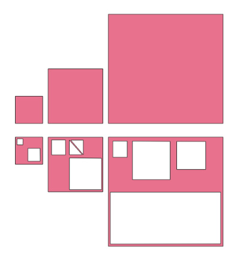
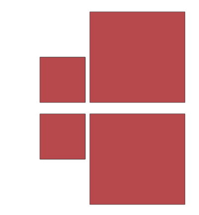

# sieve

_Sieves small polygon geometries out of a GeoPackage, written in Go._

[](https://github.com/PDOK/sieve/releases)
[](https://hub.docker.com/r/pdok/sieve)
[](https://github.com/PDOK/sieve/blob/master/LICENSE)

## Description

sieve reads a source [GeoPackage](https://www.geopackage.org/) and writes a new,
sieved GeoPackage. For every table containing `POLYGON` or `MULTIPOLYGON`
geometries, it filters out (or, for a `MULTIPOLYGON`, splits and filters the
individual) polygons whose area is smaller than the given resolution squared,
and it removes interior rings whose area is smaller than that same
threshold.<!-- source: pkg/sieve.go:20-49,80-100 --> Tables containing other
geometry types are copied unchanged.<!-- source: main.go:70-80 -->

The purpose is to prerefine `(MULTI)POLYGON` geometries in a GeoPackage used
for vector tiles, filtering out geometries smaller than the pixels generated
at a given resolution. This avoids rendering artifacts and reduces the amount
of data that needs to be processed.

## Installation

### Docker

```sh
docker build -t pdok/sieve .
```

### Local

```sh
go build .
```

## Usage

```sh
docker run --rm --name sieve -v `pwd`/example:/example pdok/sieve /sieve \
  -s=/example/example.gpkg -t=/example/example-processed.gpkg -r=50001 -p=10
```

Or, when built locally:

```sh
./sieve -s=[source GPKG] -t=[target GPKG] -r=[resolution] -p=[pagesize]
```

<!-- source: main.go:22-53 -->
| Flag | Env var | Description | Default |
| --- | --- | --- | --- |
| `-s`, `--source` | `SOURCE_GPKG` | Source GeoPackage (required) | - |
| `-t`, `--target` | `TARGET_GPKG` | Target GeoPackage (required) | - |
| `-r`, `--resolution` | `SIEVE_RESOLUTION` | Threshold area (`resolution * resolution`) below which a feature is sieved | `0.0` |
| `-p`, `--pagesize` | `SIEVE_PAGESIZE` | Number of features written per transaction to the target GeoPackage | `1000` |

Running the example above against [`example/example.gpkg`](example/example.gpkg)
results in the following:

 

## Develop

### Prerequisites

- Go 1.18<!-- source: go.mod:3 -->
- The `libsqlite3-mod-spatialite` library, required at runtime for creating
  the RTree triggers used to maintain the spatial index<!-- source: Dockerfile:32-34 -->

### Testing

```sh
go test ./... -covermode=atomic
```

No lint configuration or CI workflow currently exists in this repository.

## Contributing

sieve is developed by PDOK. Contributions are welcome; please open an issue
or pull request in the issue tracker.

## Contact

Contacting the maintainers can be done through the issue tracker.

## Authors

This project is developed by [PDOK](https://www.pdok.nl/), a platform for
publication of geographic datasets of Dutch governmental institutions.
